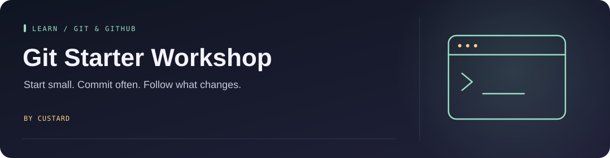

<!-- Project artwork created for this repository. -->
<p align="center">
  
</p>

<h1 align="center">Git Starter Workshop</h1>

<p align="center">
  
</p>

**A hands-on introduction to repositories, commits, branches, and pull requests.**

<p align="center"><a href="#start-here">Start here</a> &nbsp; · &nbsp; <a href="#learn-next">Learn next</a></p>

## Start here

1. Install [Git](https://git-scm.com/downloads).
2. Fork this repository if you want to push your own changes.
3. Clone your copy and open [Completed.md](Completed.md).
4. Make a small edit, inspect the diff, and commit it.

```bash
git status
git diff
git add Completed.md
git commit -m "Complete the starter exercise"
git push
```

Use an authentication method supported by GitHub, such as SSH or GitHub CLI. Your account password is not a Git HTTPS credential.

## Learn next

- **Commit:** save a meaningful change in your local history.
- **Branch:** work on a change separately from the main line.
- **Pull request:** propose that another branch or repository accept your changes.

The [original workshop](docs/WORKSHOP.md) includes terminal exercises and the longer walkthrough. It is retained as historical teaching material; some UI and authentication instructions are dated.

Based on the [USRC Git workshop](https://github.com/usydroboticsclub/intro). This repository is a learning copy, not a new Git tool.

See [source and rights](docs/SOURCE_AND_RIGHTS.md) before reusing imported exercises or media.
